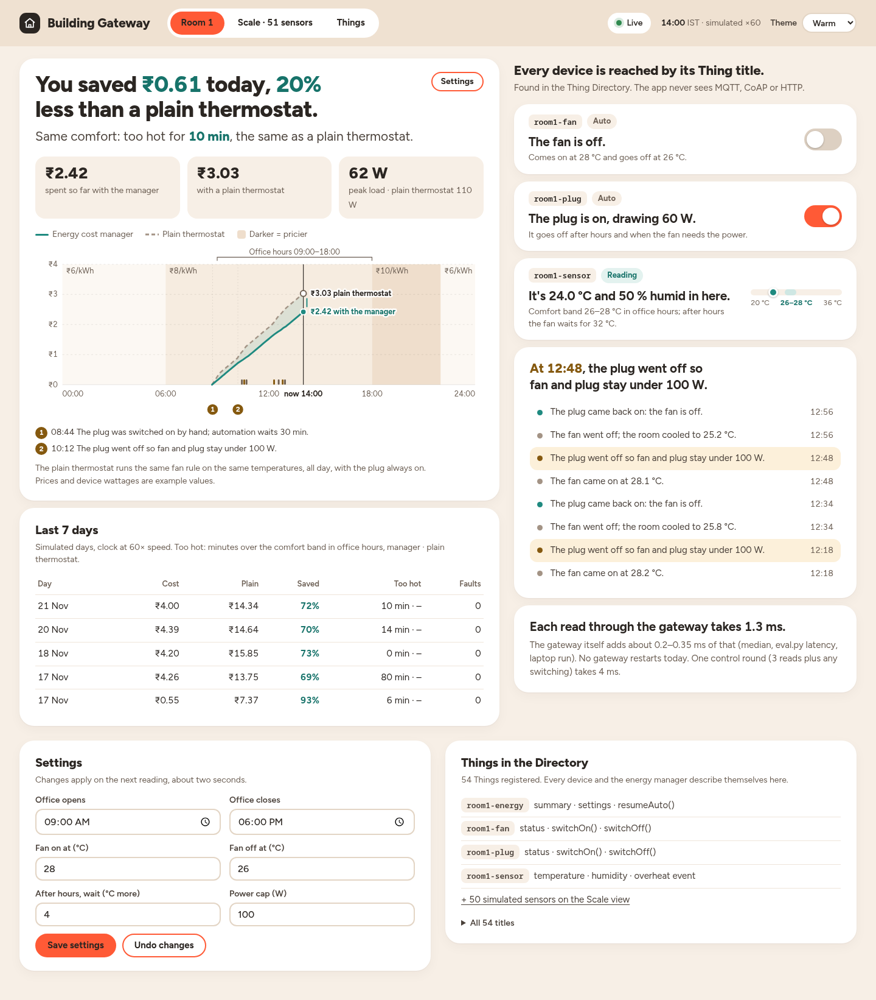

# WoT Energy Gateway

A Raspberry Pi gateway that puts MQTT, CoAP and HTTP devices behind W3C Web of Things (WoT)
Thing Descriptions, so one app controls all of them without knowing the protocol, and an
**energy cost manager** built on top of it for an office room.

The manager meters energy and cost under a time-of-day tariff, relaxes cooling after office
hours, switches the plug off when nobody is there, sheds it when the room would exceed a power
cap, respects manual overrides, and flags a fan that runs without cooling the room. It is itself
a Thing: its summary is readable and its settings writable over the same standard. Over a
simulated day it costs about 70% less than a plain thermostat at the same comfort, and across 50
rooms the hardware pays for itself in under 8 months (`python3 eval/eval.py energy`).



## Architecture

```
 DHT11 sensor ──MQTT──┐
 Fan relay ──CoAP/MQTT┼──► node-wot gateway ──HTTP :8080──► Energy cost manager (Thing room1-energy, :8093)
 Smart plug ───HTTP───┘        │
 Simulated sensors ──MQTT──►   └─ registers each Thing ──► Thing Directory :9000 ◄── manager + dashboards look up
```

- Each device has a Thing Description (TD) with its native protocol forms (`tds/`).
- The gateway consumes those TDs and re-exposes every Thing over HTTP with the same names.
- Each TD says what the device is and which room it is in, with ETSI SAREF terms. The manager and the dashboards
  find Things by that meaning ("the temperature in room1"), never by title, and only use URLs found in the TDs.
- Swapping the fan from CoAP to MQTT changes only which TD the gateway loads; nothing else changes.
- The fan's TD can list both protocols (`tds/fan.json`). The gateway then picks one per request and fails over
  when it stops answering, so the manager never notices a protocol going down.

## Repository layout

| Folder | What |
|--------|------|
| `gateway/` | node-wot gateway, Thing Directory, the dashboards (`dashboard.html`, `scale.html`, `theme.css`, self-hosted fonts) |
| `app/` | energy cost manager: tariff, office-hours schedule, power cap, overrides, fault detection, day reports |
| `devices/` | MQTT sensor, CoAP relay, MQTT relay, HTTP plug, per-device panels (`gui.py`), `sim/` simulator |
| `firmware/` | ESP32 / ESP8266 firmware for the distributed demo (Level 3) |
| `eval/` | latency, CPU/RAM, plots, energy business case, control-loop and swap timing |
| `tds/` | Thing Description generator and generated TDs |
| `docs/` | demo-day runbook, Level 3 pinout, screenshots |
| `logs/` | build log |

Interfaces (topics, paths, ports, Thing titles) are in the code and the TDs generated by `tds/gen.py`.

## Quick start (everything on one machine)

Requirements: Node 20+, Python 3.10+, an MQTT broker (mosquitto, or `docker run -p 1883:1883 -v $PWD/devices/mosquitto.conf:/mosquitto/config/mosquitto.conf eclipse-mosquitto:2`).

```sh
python3 -m venv devices/.venv && devices/.venv/bin/pip install paho-mqtt aiocoap flask
(cd gateway && npm install)
SIM=50 ./lab.sh level1          # broker check, mock devices, 50 simulated sensors, gateway, manager
./lab.sh status                 # what is running
./lab.sh stop
```

Or by hand:

```sh
mosquitto -c devices/mosquitto.conf &            # broker on :1883
python3 tds/gen.py                               # TDs pointing at localhost
python3 devices/sensor.py --mock --gui 8090 --fan-status http://localhost:8080/room1-fan/properties/status &
python3 devices/coap_relay.py --mock --gui 8092 --mqtt localhost &   # fan over CoAP and MQTT
python3 devices/http_plug.py --gui 8091 &
(cd gateway && node gateway.js)                  # gateway :8080, Directory + dashboards :9000
python3 app/app.py --speed 60 --start 8          # manager; 1 simulated hour per minute
```

## Dashboards

- **http://localhost:9000/**, the room dashboard:
  - The day's verdict as a sentence: money saved against a plain thermostat, and comfort compared too.
  - The cost race over the day, with price periods and numbered decisions.
  - Each device, found by what it is and labelled with its Thing title, with what automation did and why, plus a switch and **Resume auto**.
  - Today's decisions on the simulated clock, gateway timing, the last 7 days, settings, and the Directory.
- **http://localhost:9000/scale**: every sensor's live temperature, plus the gateway host's CPU, temperature and memory.
- **Themes:** Auto (follows the system), Warm, Night, Ocean and Lilac, picked in the header and shared by both pages.
- **Device panels** on `:8090`–`:8092`. The sensor panel has demo triggers: Heat/Cool nudge, and Open/close window, which makes the fan-fault alert fire.
  The fan panel has Drop/Restore CoAP and MQTT, which cut one protocol path while the fan keeps running.

## Demo levels

1. **Simulation**: everything mocked on the laptop. No hardware risk.
2. **Raspberry Pi 4B all-in-one**: all three protocols with the real sensor and relay on one Pi.
3. **Distributed**: one ESP32/ESP8266 board per protocol into the Pi gateway (`firmware/`, `docs/level3-pinout.md`).

If a level fails during the demo, fall back to the one below. `docs/demo-day-runbook.md` has addresses,
bring-up per level and the pre-demo checklist.

### Hardware (Level 2, no `--mock`)

- **Raspberry Pi 4 Model B**: gateway, MQTT broker on `:1883`.
- **DHT11 sensor** on BCM GPIO4 (`sensor.py --pin 4`). `sensor.py` still constructs a DHT22; switch it to DHT11.
- **SRD-05VDC-SL-C relay** (5 V, active-low input) on BCM GPIO17 (`coap_relay.py --pin 17`). `common.py` is active-high by default; set `active_high=False`. It drives an LED standing in for the fan.
- **Ports:** gateway `:8080`, Directory and dashboards `:9000`, CoAP `:5683`, HTTP plug `:8081`, manager `:8093`.
- **Network:** everything shares one phone hotspot, and its DHCP addresses change, so regenerate the TDs each session with `python3 tds/gen.py --broker PI --coap H --plug H` and start `node gateway.js --host PI_IP`. If the laptop can't reach the Pi, ping the laptop from the Pi once (the hotspot forwards ARP lazily); details in the runbook.

## Swap test

```sh
node gateway.js ../tds/sensor.json ../tds/fan-coap.json ../tds/plug.json   # CoAP fan
node gateway.js ../tds/sensor.json ../tds/fan-mqtt.json ../tds/plug.json   # MQTT fan
```

The manager and dashboards keep working unchanged. `eval.py control` measures how long control is lost.

## Protocol failover

`tds/fan.json` gives the fan both a CoAP and an MQTT form for every interaction, which a TD allows and
leaves to the consumer to choose. The gateway (the consumer) chooses:

- it uses the TD's first protocol, CoAP, and probes every protocol on `status` every 2 s;
- a protocol that doesn't answer within 1 s is down, and the same request is retried on the next one;
- it moves to a working protocol for speed only when that one is more than 2× faster (+5 ms) over the
  smoothed latency, so it doesn't flip on LAN noise. After a failover it goes back to CoAP that way.

The choice is itself readable: the gateway adds a `protocol` property to `room1-fan`
(`{"active": "coap", "health": {...}, "switched": {...}}`). The dashboard shows "via CoAP · MQTT standby"
on the fan card and logs every switch. Demo: click **Drop CoAP** on the fan panel (`:8092`).
The MQTT side of the fan clears its retained status when it drops (and through its MQTT will when it
dies), so the broker never answers for a dead device.

## Semantic discovery

The TDs are JSON-LD, so each one carries what the device is, from ETSI SAREF (core 3.2.1) and SAREF4BLDG (1.1.2):

| Thing | Thing `@type` | Affordance `@type`s | Room |
|-------|---------------|---------------------|------|
| sensor | `saref:TemperatureSensor` | `temperature` → `saref:Temperature`, `humidity` → `saref:Humidity` | `s4bldg:isContained` `urn:building:room1` |
| fan | `s4bldg:Fan`, `saref:Actuator` | `status` → `saref:OnOffState`, `switchOn/Off` → `saref:OnCommand/OffCommand` | same |
| plug | `s4bldg:Outlet`, `saref:Switch`, `saref:Meter` | same as the fan, plus `power` → `saref:Power` | same |

The manager asks the Directory for the Thing in its room (`--room`) that has a `saref:Temperature`, the one that is
an `s4bldg:Fan` and the one that is an `s4bldg:Outlet`, then uses the property or action whose type it needs
(the action that is a `saref:OnCommand`, not the one called `switchOn`). Prefixes are expanded with each TD's own
`@context`, so a vendor writing `s:Temperature` with `s` mapped to SAREF matches too. The dashboard does the same.
The gateway passes `@context`, `@type` and the room through to the TDs it exposes.

**Rename test:** give the three TDs other titles (`acme-thermo-7`, `ceiling-fan`, `desk-socket`), other prefixes
(`s:` / `b:`) and other property and action names (`temp`, `state`, `on`, `off`), then restart only the gateway.
The manager carried on after one 2 s reconnect and switched the fan through the renamed `off`, including over MQTT
during failover; the dashboard found all three. `app/test_app.py` checks the same matching, plus a sensor in another
room and an unplaced simulated one.

What stays a contract: the payload shapes (`{"on": …}`, the plug's `power`) and the sensor's `overheat` event name,
which SAREF has no term for (the manager skips the overheat watcher if a sensor has no such event).

## Evaluation

```sh
python3 eval/eval.py latency --gw PI --plug H --coap H -n 200   # direct vs through the gateway
python3 eval/eval.py resources --procs gateway.js --label n50   # gateway CPU/RAM (simulator running)
python3 eval/eval.py plot
python3 eval/eval.py energy --rooms 50                           # plain vs manager, settings sweep, payback
python3 eval/eval.py control --seconds 60 --probe http://PI:8080/room1-fan/properties/status
```

Measured on one laptop (Level 1, 50 simulated sensors), November 2026. Pi numbers still to do.

| What | Result |
|------|--------|
| Energy manager vs plain thermostat (replay of one room-day) | ₹3.84 vs ₹13.42, 71% less, same 3 min too hot; peak 60 W vs 110 W |
| Payback, 50 rooms (₹1,500 per room + ₹6,000 Pi, 22 working days) | ₹10,534 saved per month, 7.7 months |
| Gateway overhead per request (median, direct → gateway) | plug read 0.44 → 0.79 ms, CoAP read 0.42 → 0.58 ms, CoAP action 0.34 → 0.52 ms |
| Control loop (3 reads plus actions through the gateway) | median 4 ms, p95 45 ms |
| Swap CoAP ↔ MQTT, control lost | 0–3 s (at most one 2 s round) |
| Failover CoAP → MQTT (Drop CoAP), control lost | 3.0 s, one round; the request that hit the dead path took 1.0 s |
| Fan status read through the gateway, CoAP vs MQTT form | 1.2 ms vs 42 ms (node-wot subscribes per MQTT read) |
| Rename test: other titles, prefixes and affordance names, lines of manager/dashboard code changed | 0 |
| Gateway CPU / RAM, N sensors read every 2 s | N=10: 1.0% / 172 MB, N=100: 2.9% / 193 MB |

The replay uses a simple one-room thermal model, and the tariff, wattages and hardware prices are
example values, so treat the energy numbers as modelled, not measured.

## Tests

```sh
cd gateway && npm test                 # failover choice, Directory API
python3 app/test_app.py                # rules, tariff, overrides, faults, settings validation, replay, semantic discovery
python3 devices/test_devices.py        # CoAP relay + plug
```

## Limitations

- Events use HTTP long-poll (no WebSocket binding).
- The Directory is in-memory, so the gateway and the manager register again after every start.
- node-wot can exit on an internal event-listener error ("Form not found"); restart the gateway if it does.
- Only tested with mock devices on one machine so far.
- An MQTT command is fire-and-forget: if the fan dies between two probes (2 s), a command sent over MQTT in
  that window is lost. CoAP commands are acknowledged.
- Failover is wired for the fan only. Level 3 runs `fan-coap.json`, since the ESP8266 fan speaks CoAP only.
- Semantic matching expands compact prefixes from each TD's `@context`; it doesn't fetch remote JSON-LD contexts or
  reason over subclasses (a `saref:TemperatureSensor` is not inferred to be a `saref:Sensor`). The scale view still
  finds sensors by the property name `temperature`.
- The manager's own Thing `room1-energy` is found by title: it is the dashboard's backend, not a device.

## Safety

Run it on an isolated network. Never switch mains power with the relay: low-voltage DC or an LED only.
